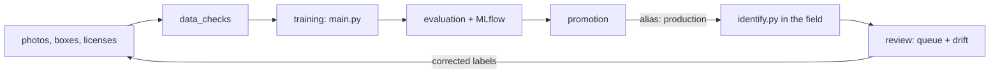

# Pipelines: data checks, evaluation, promotion and monitoring

The project's training and identification code (`main.py`, `identify.py`) runs inside
[Kedro](https://kedro.org) pipelines, with [MLflow](https://mlflow.org) for experiment tracking and
the model registry and [Pandera](https://pandera.readthedocs.io) for table contracts. The pipelines
add what a model needs before and after it is used:

1. **Data checks** before training: is every photo readable, licensed, correctly boxed and in
   exactly one split?
2. **Training** with `main.py`, only when the data checks pass.
3. **Evaluation**: one standard report for every version, logged to MLflow, with the model
   registered in the MLflow model registry.
4. **Promotion**: a new version replaces the one in use only when it is better on the rules in
   `conf/base/parameters.yml`.
5. **Review and monitoring**: uncertain birds from field photos go to a review queue, and field
   photos are compared with the training photos to catch drift.



The checks, reports and the promotion gate live in `src/bok_pipelines/reliability/`. They know
nothing about birds and work for any folder-of-labels image dataset.

## Setup

In the same virtual environment as the rest of the project:

```bash
pip install -r requirements-pipelines.txt
```

## Running

Run every command from the repository root. The model version comes from `conf/base/globals.yml`
(now `2.1`); `--params version=...` changes it for one run.

```bash
kedro run                                        # check data, evaluate and promote the version in globals.yml
kedro run --pipelines data_checks                # data checks only
kedro run --pipelines release --params version=1.2   # new version end to end: check, train, evaluate, promote
kedro run --pipelines review                     # after identify.py: review queue and drift report
pytest tests                                     # tests for the reliability components
mlflow ui --backend-store-uri sqlite:///mlflow.db    # browse runs and models at http://127.0.0.1:5000
```

For an interactive map of the pipelines: `pip install kedro-viz`, then `kedro viz run`.

The first data check reads every training photo and takes a few minutes. For a quick trial, add
`--params data_checks.max_images_per_label=20`; training and promotion do not accept the result of
a trial run, only a check of every photo.

A version written like `1.10` must be quoted, `--params "version='1.10'"`, or Kedro reads it as
the number 1.1.

Training settings (epochs, `--from-annotations`, `--split-from`, ...) are under `training:` in
`conf/base/parameters.yml` and are passed to `main.py` unchanged. To change a setting only on your
computer, put it in `conf/local/parameters.yml`, which git ignores, for example:

```yaml
training:
  epochs: 15
```

## What each pipeline writes

| Pipeline | File | In git |
|---|---|---|
| data_checks | `reports/<version>/data_checks.json`: every check, passed or failed, with counts | yes |
| | `data/pipeline/<version>/data_check_issues.csv`: one row for each problem photo | no |
| | `data/pipeline/<version>/image_index.csv`: hash, size and brightness of every photo | no |
| training | everything `main.py` writes (model, label list, splits, `reports/<version>/`) | as before |
| evaluation | `reports/<version>/evaluation_report.json` and `evaluation_per_species.csv` | yes |
| | `data/pipeline/<version>/test_predictions.csv`: every test photo with its prediction | no |
| | an MLflow run, and the model registered with the alias `candidate` | no (`mlflow.db`) |
| promotion | `reports/<version>/promotion_decision.json`: the decision and every reason | yes |
| | `reports/production.json` and the MLflow alias `production`: the version in use | yes / no |
| review | `outputs/review/field_predictions.csv`, `review_queue.csv`, `monitoring_report.json` | no |

## 1. Data checks

| Check | Fails when | Blocks training |
|---|---|---|
| metadata_table | `data/gbif_metadata.csv` is missing, or a row lacks a file, species or license, or lists a file twice | yes |
| unreadable_images | a photo cannot be opened (truncated download, not an image) | yes |
| conflicting_labels | the same photo (same content hash) sits in two species folders | yes |
| licenses | a photo has no license record, or a license outside CC0, CC BY, CC BY-SA, CC BY-NC, CC BY-NC-SA | yes |
| annotations | a box file names another species, a box lies outside the photo, the recorded size differs from the photo, or the photo has an EXIF rotation (boxes are drawn on the turned photo, but training reads the stored pixels) | yes |
| split_integrity | a photo is in two splits, a photo in test has an identical copy in train, a listed photo is missing, or a species is missing from a split | yes |
| duplicate_images | the same photo twice in one species folder | no, warning |
| too_small_images | smaller than 64 x 64 pixels | no, warning |
| labels_with_too_few_images | fewer usable photos than `main.py --min-images` | no, warning |

Photos in `data/annotations/exclude.csv` are left out, as in training. Which checks block is set
under `data_checks.blocking`. When `conflicting_labels` or `duplicate_images` fails, run
`python3 scripts/exclude_duplicates.py`: it lists every copy of a photo filed under two species, and
the extra copies of a photo saved twice under one species, in `exclude.csv`.

## 3. Evaluation

When the model file is on this computer, the pipeline runs it again on the version's own test
photos (the same crops `main.py` tested on) and checks that the accuracy matches
`reports/<version>/metrics.json`. Otherwise it builds the report from the files `main.py` committed.
The report adds to `main.py`'s metrics:

- **calibration** (expected calibration error): does a 70% confidence mean right 70% of the time?
- **accuracy above the confidence cut-off** used by `identify.py`, and the share of photos above it
- **rare and common species** separately (rare: 20 training photos or fewer)
- the ten hardest species

## 4. Promotion

The candidate is compared with the version in production, recorded in `reports/production.json`
(committed with the code) and mirrored by the MLflow alias `production`; `fallback_baseline` (now
`2.0`) is used when nothing is in production yet. It is promoted only if:

- its data checks passed on every photo
- accuracy is at least as high, and macro F1 does not fall
- accuracy on rare species does not fall
- no species with 15 or more test photos loses more than 20 points of recall

Run on the committed reports, 1.1 passes against 1.0: accuracy 44.9% to 63.2%, macro F1 0.384 to
0.569, rare-species accuracy 17.2% to 32.6%, and no species regresses.

To use the production model from any script:

```python
import mlflow, pandas as pd
mlflow.set_tracking_uri("sqlite:///mlflow.db")
model = mlflow.pyfunc.load_model("models:/birds-of-kenya-classifier@production")
model.predict(pd.DataFrame({"path": ["data/images/images_from_field/photo.jpg"]}))
```

## 5. Review and monitoring

After running `identify.py` on field photos, `kedro run --pipelines review`:

1. collects every bird from `outputs/identify/*_identified.json`;
2. writes `outputs/review/review_queue.csv`, the unidentified and low-confidence birds, least
   certain first. Fill in `correct_label` (the species folder name, e.g. `Passer_domesticus`),
   `reviewer` and `reviewed_on`. Re-running keeps every row already reviewed;
3. writes `outputs/review/monitoring_report.json` and logs it to MLflow:
   - **photo drift**: brightness, contrast and shape of field photos against the training photos,
     as a population stability index (under 0.1 stable, over 0.25 strong drift);
   - **confidence drift**: the model's confidence on field birds against its confidence on the test
     photos;
   - **reviewed accuracy**: how many reviewed birds the model named correctly. The queue holds the
     least certain birds, so this is a lower bound.

Corrected photos can be boxed and added to `data/images/sorted_data/` for the next version.

## Files

```
conf/base/                 globals.yml (version), parameters.yml (all settings), catalog.yml (file locations)
conf/local/                your own overrides, not in git
src/bok_pipelines/
├── reliability/           data checks, evaluation report, promotion gate, drift and review queue,
│                          Pandera table contracts, MLflow model wrapper
├── pipelines/             data_checks, training, evaluation, promotion, review
└── pipeline_registry.py   release = data_checks + training + evaluation + promotion
tests/                     pytest tests for reliability/
```
